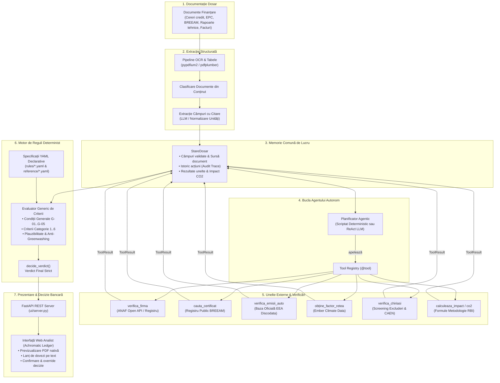

# Green Proof — Autonomous AI Agent for Green Lending & ESG Eligibility

> **Sistem inteligent autonom pentru verificarea eligibilității creditelor corporative în portofoliul de obligațiuni verzi (*Green Lending & ESG Portfolios*), conform *RBI Sustainability Bond Framework 2025* și *Taxonomiei UE*.**

[](https://www.python.org/)
[](https://fastapi.tiangolo.com/)
[](https://docs.pydantic.dev/)
[-brightgreen.svg)]()
[-success.svg)]()
[]()

---

## 1. Prezentare Generală

**Green Proof** este un asistent agentic dezvoltat pentru eficiență operațională bancară, dedicat departamentelor de risc de credit, ESG și sustenabilitate. Sistemul analizează creditele corporative **deja aprobate**, extrage dovezile tehnice din documentația depusă, interoghează baze de date și registre oficiale independente (ANAF, BREEAM, EEA Discodata), evaluează regulile de conformitate ecologică, calculează impactul de mediu (emisii de CO₂ evitate) și pregătește dosare auditate pentru **Sustainability Bond Committee**.

### Misiunea Proiectului:
- **Reducerea timpului de analiză** de la zile la secunde per dosar de credit.
- **Eliminarea greenwashing-ului** prin validări încrucișate de plauzibilitate și interogarea registrelor externe oficiale.
- **Transparență și auditabilitate 100%**: fiecare afirmație, valoare și decizie trimite direct la documentul sursă, pagina exactă și citatul verificat.
- **Separare clară de responsabilități**: inteligența artificială (LLM) planifică și explorează, dar **verdictul este calculat determinist de motorul matematic și logic**.

---

## 2. Arhitectura Sistemului

Sistemul este complet decuplat, componentele comunicând exclusiv prin contracte tipizate ([contracts.py](file:///c:/Users/Andrei/Desktop/Nexxt-AI-Project/contracts.py)) și registrul de unelte ([registry.py](file:///c:/Users/Andrei/Desktop/Nexxt-AI-Project/registry.py)):



---

## 3. Cele 6 Categorii de Finanțare Verde (Taxonomia UE & RBI)

Green Proof acoperă toate cele 6 domenii majore de creditare verde reglementate în *RBI Sustainability Bond Framework 2025* și *Taxonomia UE*, definite declarativ în folderul `rules/`:

| Categorie | Fișier Reguli | Criterii Cheie de Eligibilitate | Căi Alternative & Condiții Speciale |
|---|---|---|---|
| **Clădiri Verzi**<br>`green_buildings` | `rules/green_buildings.yaml` | • **GB-01**: Certificare sustenabilitate (BREEAM ≥ Excellent, LEED Gold, DGNB)<br>• **GB-02**: Top 15% fond național de clădiri<br>• **GB-03**: Certificat Energetic EPC Clasa A<br>• **GB-04**: Consum de energie primară cu ≥ 10% sub pragul NZEB | Căile sunt alternative (ajunge să fie îndeplinită una). Include screening obligatoriu de chiriași (**GB-X1**) pentru excluderea activităților de extracție/prelucrare combustibili fosili. |
| **Energie Regenerabilă**<br>`renewable_energy` | `rules/renewable_energy.yaml` | • **RE-01**: Solar fotovoltaic, energie eoliană, energie geotermală<br>• **RE-02**: Hidrocentrale (densitate putere > 5 W/m² sau emisii GHG < 50 gCO₂e/kWh)<br>• **RE-03**: Biomasă/biogaz sustenabil (reducere emisii ≥ 80% vs combustibili fosili) | Suportă contracte directe de achiziție de energie verde (PPA) și monitorizarea cotei de finanțare a băncii. |
| **Transport Curat**<br>`clean_transport` | `rules/clean_transportation.yaml` | • **CT-01**: Vehicule electrice și pe hidrogen (0 gCO₂/km)<br>• **CT-03**: Vehicule hibride plug-in cu emisii WLTP < 50 gCO₂/km (până la 31.12.2025)<br>• **CT-04**: Flote comerciale ușoare N1 cu mix de vehicule curate | **Regulă de tranziție**: din 01.01.2026, pragul de emisii scade la 0 gCO₂/km. Verificare automată împotriva bazei oficiale EEA pentru detectarea conflictelor de emisii declarate vs. reale. |
| **Eficiență Energetică**<br>`energy_efficiency` | `rules/energy_efficiency.yaml` | • **EE-01**: Modernizări industriale cu economie de energie primară de cel puțin 30%<br>• **EE-07**: Centre de date (*Data Centers*) cu PUE (*Power Usage Effectiveness*) ≤ 1.40<br>• **EE-04**: Pompe de căldură cu refrigeranți având potențial de încălzire globală (GWP) sub plafoanele F-Gas | Verificare split renovare profundă vs. echipamente individuale. |
| **Prevenirea & Controlul Poluării**<br>`pollution_control` | `rules/pollution_prevention.yaml` | • **PP-01**: Instalații municipale de sortare și reciclare mecanică a deșeurilor<br>• **PP-06**: Sisteme de captare și utilizare a biogazului din depozite conforme de deșeuri | Se exclud instalațiile de incinerare fără valorificare energetică ridicată. |
| **Economie Circulară**<br>`circular_economy` | `rules/circular_economy.yaml` | • **CE-01**: Produse concepute pentru reutilizare, dezmembrare și reciclare de înaltă eficiență<br>• **CE-03**: Producție de aluminiu reciclat cu emisii specifice reduse (conform cerințelor de bune practici) | Audit pe cota de material reciclat utilizat în procesul de fabricație. |

---

## 4. Condiții Generale & Filtre Excludere (Do No Significant Harm)

Înainte de analiza pe categorii, fiecare dosar trebuie să treacă de cele 5 condiții generale de eligibilitate ([rules/conditii_generale.yaml](file:///c:/Users/Andrei/Desktop/Nexxt-AI-Project/rules/conditii_generale.yaml)):
1. **G-01 (Eligibilitate Geografică):** Proiectul și împrumutatul se află într-o țară eligibilă conform Anexei B (România, Austria, Cehia, Slovacia, Ungaria, etc.).
2. **G-02 (Excluderi Sectoriale & Stare Firmă):** Codul CAEN al împrumutatului nu face parte din sectoarele excluse (tutun, armament, cărbune, combustibili fosili, jocuri de noroc) și firma este activă fiscal (fără proceduri de insolvență/radiere în baza ANAF).
3. **G-03 (Excluderi Chiriași Clădiri):** Suprafața închiriată entităților din sectoare interzise nu depășește pragurile de toleranță.
4. **G-04 (Fereastra de Refinanțare):** Proiectele de refinanțare sunt aprobate în fereastra de maximum 24 de luni anterioare anului alocării.
5. **G-05 (Investiții Noi vs. Refinanțare):** Evidențierea clară a destinației fondurilor (CAPEX nou vs. refinanțare bilanțieră).

---

## 5. Anti-Greenwashing & Verificări de Plauzibilitate

Pentru a preveni raportările eronate sau tentativele de fraudare a indicatorilor ESG, motorul rulează reguli stricte de plauzibilitate ([reference/plauzibilitate.yaml](file:///c:/Users/Andrei/Desktop/Nexxt-AI-Project/reference/plauzibilitate.yaml)):
- **PL-01 / PL-02 (Discrepanțe de Emisii Auto):** Compararea valorii declarate a emisiilor WLTP cu registrul oficial european EEA Discodata. Dacă valoarea declarată diferă de datele oficiale de omologare, registrul oficial are prioritate, iar dosarul este escaladat la comitet.
- **PL-10 (Valori Energetice Imposibile):** Verificarea consumului specific EPC (kWh/m²/an) împotriva limitelor fizice posibile (ex. detectarea erorilor de unități kWh vs. MWh).
- **PL-20 (Factor de Capacitate Regenerabil):** Detectarea anomaliilor fizice de producție (ex. factor de capacitate de peste 25% la instalații solare fotovoltaice fără stocare).
- **Clasificare Granulară a Severității:**
  - `blocant` (implicit) $\rightarrow$ generează verdictul `EXCEPTIE_ESCALADARE_COMITET` cu dovezi pregătite.
  - `informativ` $\rightarrow$ adaugă avertismente în raport pentru atenția ofițerului de credit, fără a bloca automat procesul.

---

## 6. Motorul de Calcul Impact (Emisii CO₂ Evitate)

Impactul de mediu este calculat transparent prin funcția canonică [engine/impact.py](file:///c:/Users/Andrei/Desktop/Nexxt-AI-Project/engine/impact.py), conform *RBI Allocation and Impact Report 2025*:
- **Formula Clădiri Verzi:**
  $$\Delta \text{Consum} = \text{Baseline} (297\text{ kWh/m}^2/\text{an}) - \text{Consum Real EPC}$$
  $$\text{Economie Totală} = \Delta \text{Consum} \times \text{Suprafață} \times \text{Cotă Bancă} \times \text{Factor Emisie Rețea}$$
- **Clădiri în curs de construcție:** Nu se calculează impactul pe faza de șantier (Impact Report p. 18), dosarul primind verdictul `ELIGIBIL_CU_MONITORIZARE`.
- **Transparență:** Fiecare calcul generează un traseu explicativ detaliat cu pașii intermediari pentru audit.

---

## 7. Interfața Web & REST API (ui/)

Serverul modern FastAPI ([ui/server.py](file:///c:/Users/Andrei/Desktop/Nexxt-AI-Project/ui/server.py)) furnizează o interfață fără framework-uri grele de frontend (Vanilla ES6 + CSS Grid, stil „Achromatic Ledger”), optimizată pentru ergonomia analistului de risc:

```
┌─────────────────┬───────────────────────────┬────────────────────────────────────────────────────────┐
│  STATUS         │  DOSARE                   │  PANOU DE LUCRU DOSAR                                  │
│  • Toate (21)   │  • dosar_01_complet...    │  [Pas 1: Fișiere] [Pas 2: Raport] [Pas 3: Decizie]    │
│  • Aprobate (8) │  • dosar_02_chirias...    │                                                        │
│  • Escaladare   │  • dosar_03_breeam...     │  Concluzie Agent: EXCEPTIE_ESCALADARE_COMITET          │
│  • Respinse (4) │  • caz_01_transport...    │  Criterii Verificate:                                  │
│                 │  • caz_03_camion_eea...   │   ▶ G-01 Țară eligibilă [OK] · Cerere p.1             │
│                 │                           │   ▶ GB-01 Certificare [SEMNAL] · Certificat p.1        │
│                 │                           │                                                        │
│                 │                           │  ▼ Date extrase (25)                                   │
│                 │                           │    CUI: 9900000030  · RASPUNS_ANAF.pdf, p.1          │
│                 │                           │    Țara: România    · 01_cerere_finantare.pdf, p.1     │
│                 │                           │                                                        │
│                 │                           │  [Ia Decizia] [Descarcă Raportul Printabil]           │
└─────────────────┴───────────────────────────┴────────────────────────────────────────────────────────┘
```

### Principalele Endpoint-uri REST:
- `GET /api/dosare`: Lista tuturor dosarelor, rezumatele și statusul deciziei curente.
- `GET /api/dosare/{id}`: Detaliile complete ale dosarului, documentele clasificate și câmpurile extrase cu surse.
- `POST /api/dosare/{id}/evaluare`: Rulează agentul și calculează verdictul cu protecție de concurență granulară per-dosar.
- `GET /api/dosare/{id}/raport`: Raportul structurat de analiză (îndeplinite, de verificat, impact, referințe framework).
- `GET /api/dosare/{id}/raport.html`: Raport de audit generat ca document HTML printabil (*Ready-to-Print*).
- `POST /api/dosare/{id}/decizie`: Înregistrează decizia umană (Aprobă / Respinge / Intervenție Comitet) cu motivare obligatorie și confirmare de override când opinia analistului diferă de recomandarea automată.
- `POST /api/analizeaza`: Endpoint de compatibilitate pentru integrarea directă cu platforme externe (ex: Lovable, sisteme core-banking).

---

## 8. Instalare și Configurare

### Cerințe Preliminare
- **Python 3.10+** (testat și verificat pe Python 3.10, 3.11, 3.12, 3.15).
- Sistem de operare: Linux, macOS sau Windows.

### Pasul 1: Clonarea depozitului și crearea mediului virtual
```bash
git clone https://github.com/blidarul/Nexxt-AI-Project.git
cd Nexxt-AI-Project

# Creare mediu virtual
python -m venv .venv

# Activare mediu virtual
# Pe Windows:
.\.venv\Scripts\activate
# Pe Linux/macOS:
source .venv/bin/activate
```

### Pasul 2: Instalarea dependențelor
```bash
pip install -r requirements.txt
```

### Pasul 3: Configurare fișier `.env`
Copiați fișierul de configurare exemplu:
```bash
# Pe Windows:
copy .env.example .env
# Pe Linux/macOS:
cp .env.example .env
```

Configurați variabilele cheie în fișierul `.env`:
```ini
# Comutatoare Mod de Lucru
MOD_EXTRACTIE=mock     # 'mock' (folosește extras_mock.json) sau 'real' (OCR + LLM)
MOD_TOOLS=offline      # 'offline' (date locale și cache de rezervă) sau 'online' (interogări live ANAF/EEA/BREEAM)
MOD_AGENT=scriptat     # 'scriptat' (arbore determinist) sau 'llm' (agent autonom ReAct cu tool-calling)

# Setări Data și Limite
DATA_ALOCARE=2026-10-28
MAX_PASI_AGENT=15

# Configurare LLM (necesar pentru MOD_EXTRACTIE=real sau MOD_AGENT=llm)
LLM_BASE_URL=https://api.featherless.ai/v1
LLM_MODEL_TEXT=Qwen/Qwen3-32B
LLM_MODEL_VISION=google/gemma-3-27b-it
FEATHERLESS_API_KEY="cheia_ta_api_aici"
```

---

## 9. Comenzi de Rulare și Utilizare

### 1. Lansarea Interfeței Web (FastAPI)
```bash
# Pornește serverul și deschide automat browserul la http://127.0.0.1:8000
python -m ui

# Opțiuni avansate (port custom, fără deschidere automată browser)
python -m ui --fara-browser --port 8080
```

### 2. Rularea CLI pe un Singur Dosar
Pentru a inspecta traseul decizional pas cu pas direct în terminal:
```bash
python run.py dosare/dosar_01_complet_eligibil
```
Ieșirea conține: verdictul, calea de eligibilitate, pașii agentului, acțiunile recomandate și tabelul de reguli evaluate.

### 3. Rularea Benchmark-ului de Evaluare Complet
Validează performanța motorului și a agentului pe toate cele 21 de dosare de test (dosare complexe și cazuri sintetice pe toate categoriile):
```bash
# Rulare paralelă (implicit 4 workers)
python -m eval.run_eval

# Rulare secvențială
python -m eval.run_eval --workers 1
```

### 4. Rularea Suitei de Teste Automate
Toate cele 359 de teste unitare, de integrare și de contract:
```bash
pytest --tb=short
```

---

## 10. Structura Depozitului

```
Nexxt-AI-Project/
├── agent/                       # Modulul D: Bucla agentului, planificatorul și acțiunile
│   ├── orchestrator.py          # Conectează extracția, planificatorul, uneltele și verdictul
│   ├── planner.py               # Creierul agentului: PlanificatorScriptat & PlanificatorLLM
│   └── actiuni.py               # Unelte de acțiune: cere_date_client, escaladeaza_comitet
├── contracts.py                 # Modelele Pydantic partajate: StareDosar, ToolResult, Verdict
├── registry.py                  # Registrul decuplat de unelte (@tool decorator)
├── config.py                    # Încărcarea și validarea configurațiilor din .env
├── engine/                      # Modulul C: Motorul de reguli determinist
│   ├── evaluator_generic.py     # Interpretarea regulilor YAML și calculul expresiilor logice
│   ├── impact.py                # Calculul matematic al impactului CO2 și emisiilor evitate
│   ├── plauzibilitate.py        # Validări anti-greenwashing și detecție anomalii
│   ├── reguli.py                # Wrapper unelte pentru evaluare criterii
│   ├── verdict.py               # Determinarea verdictului strict și asamblarea probelor
│   └── co2.py                   # Unealtă delegată pentru calculul impactului clădirilor
├── extraction/                  # Modulul A: Pipeline de extracție din documente
│   ├── extractor.py             # Interfața publică de extracție proaspătă
│   ├── extrage_brut.py          # Etapa 1: Transformare PDF/Scan -> JSON brut
│   ├── extrage_structurat.py    # Etapa 2: Extracție câmpuri, clasificare & citate
│   ├── normalizare.py           # Conversii automate de unități energetice și validări
│   └── llm_client.py            # Client LLM robust cu cache SHA256 și reîncercări
├── tools/                       # Modulul B: Integrări externe și registre publice
│   ├── anaf.py                  # Interogare API ANAF / registru local de rezervă
│   ├── breeam.py                # Parser resilient HTML pentru registrul public BREEAM
│   ├── emisii_vehicul.py        # Interogare SQL EEA Discodata pentru parcul auto european
│   └── factor_emisie.py         # Factori de emisie rețea electrică per țară (Ember)
├── rules/                       # Specificațiile declarative de reguli în format YAML
│   ├── green_buildings.yaml     # Criteriile complete pentru Clădiri Verzi (GB-01..GB-04)
│   ├── renewable_energy.yaml    # Criteriile pentru Energie Regenerabilă (RE-01..RE-03)
│   ├── clean_transportation.yaml# Criteriile pentru Transport Curat (CT-01..CT-04)
│   ├── energy_efficiency.yaml   # Eficiență energetică, centre de date și pompe căldură
│   ├── pollution_prevention.yaml# Prevenirea poluării și captare biogaz
│   ├── circular_economy.yaml    # Economie circulară și reciclare aluminiu
│   └── conditii_generale.yaml   # Filtrele generale de eligibilitate (G-01..G-05)
├── reference/                   # Metodologii de referință, factori și plauzibilitate
├── dosare/                      # Dosare reale de credit cu documentație completă
├── eval/                        # Suita de evaluare și dosare de reguli (cazuri sintetice)
├── ui/                          # Interfața web și serverul FastAPI
│   ├── server.py                # Rute API, concurență per-dosar și gestiune decizii
│   ├── raport.py                # Generator HTML de rapoarte de audit printabile
│   └── static/                  # Frontend Vanilla JS, CSS Grid („Achromatic Ledger”)
├── tests/                       # Teste automate de contract și integrare sistem
└── run.py                       # CLI rapid pentru rularea pe un singur dosar
```

---

## 11. Rezultatele Evaluării și Verificării

Sistemul a fost auditat și verificat riguros:

- **100% Rată de Succes la Testele Automate:**
  ```text
  ============================= 359 passed in 8.42s =============================
  ```
- **100% Rată de Validare pe Benchmark-ul de Evaluare (21 dosare):**
  ```text
  =============================================================================================================================
  EVALUARE MOTOR & AGENT (Mod: SCRIPTAT, Workers: 4) | Total dosare: 21
  =============================================================================================================================
  Rezultat (SCRIPTAT): 21/21 dosare validate cu succes (100.0%).
  Evaluare REUȘITĂ: toate dosarele corespund specificațiilor din expected.json.
  ```

---

## 12. Licență

Acest proiect este licențiat sub licența **MIT** — consultați fișierul [LICENSE](LICENSE) pentru mai multe detalii.
